# PocketServer System Architecture & Systems Engineering Specification

This document provides the canonical architectural specification for PocketServer, an open-source, local web service and container hosting platform running on unrooted Android devices.

---

## 1. High-Level System Component Architecture

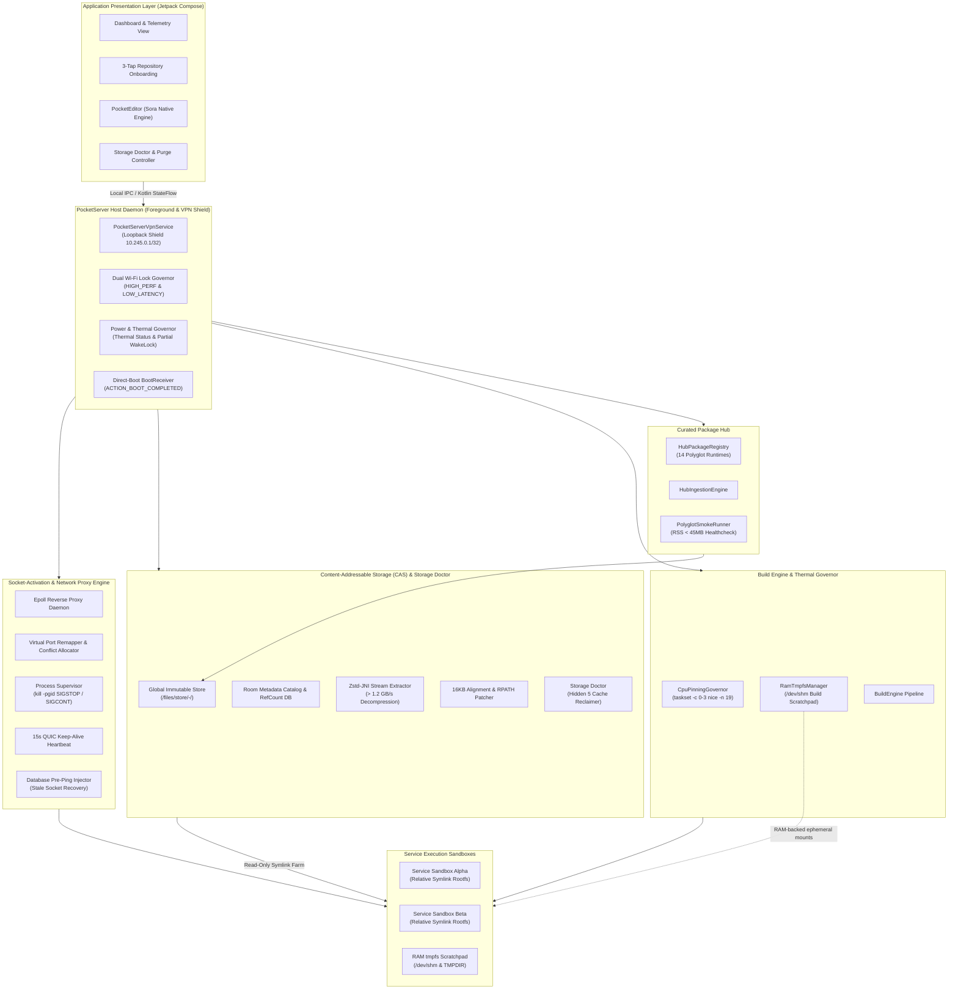

---

## 2. Socket-Activation & Sleep/Wake State Machine

PocketServer utilizes an epoll-based reverse proxy to decouple network ingress from backend CPU execution. Idle services are transitioned to a frozen state (`SIGSTOP`) where the kernel suspends CPU scheduling entirely while keeping process memory resident. Upon incoming TCP connection requests, the proxy dispatches `SIGCONT` to wake the process group in under 1 millisecond.

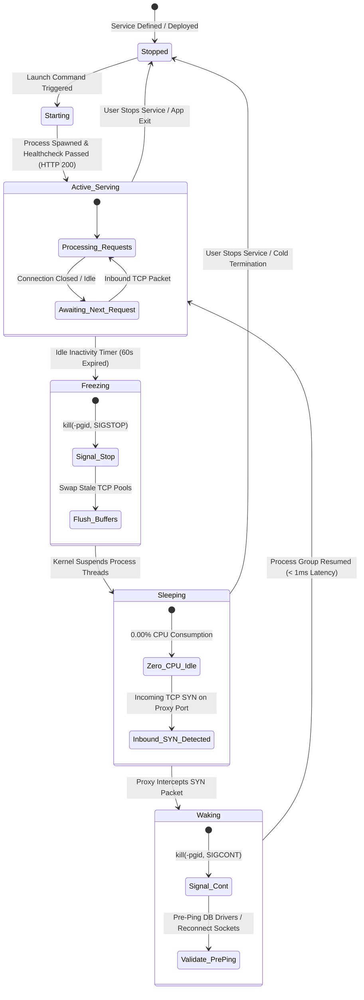

---

## 3. Process Lifecycle & `SIGSTOP` / `SIGCONT` Sequence Diagram

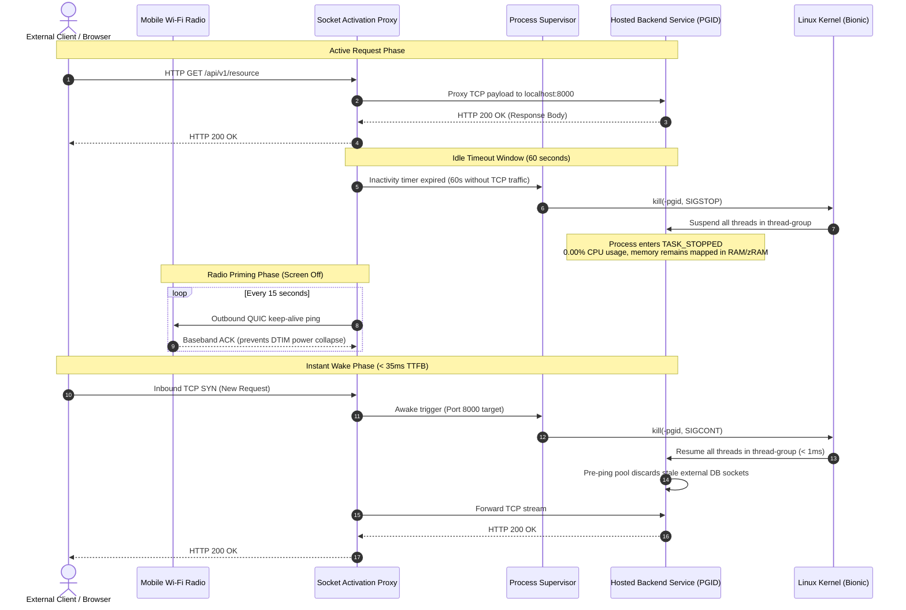

---

## 4. Build Engine & LITTLE Core CPU Pinning Architecture

Mobile SoCs (Snapdragon, Tensor, Dimensity) employ heterogeneous big.LITTLE architectures (e.g. 4 efficiency LITTLE cores + 3 performance cores + 1 prime core). Running intensive compiler toolchains (`cargo build`, `bun build`, `uv pip install`) on performance cores spikes temperatures above 42°C, causing kernel thermal throttling and rapid battery drain.

PocketServer routes all builds through `CpuPinningGovernor` and `RamTmpfsManager`:

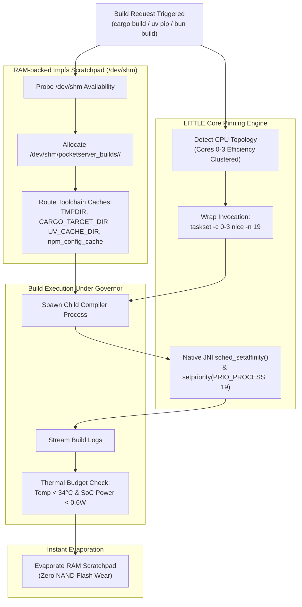

---

## 5. Storage Doctor & 1-Tap Deep Purge Flowchart

PocketServer isolates the "Hidden 5" compiler caches and ensures safe, complete reclamation without compromising user project code or immutable CAS store runtimes.

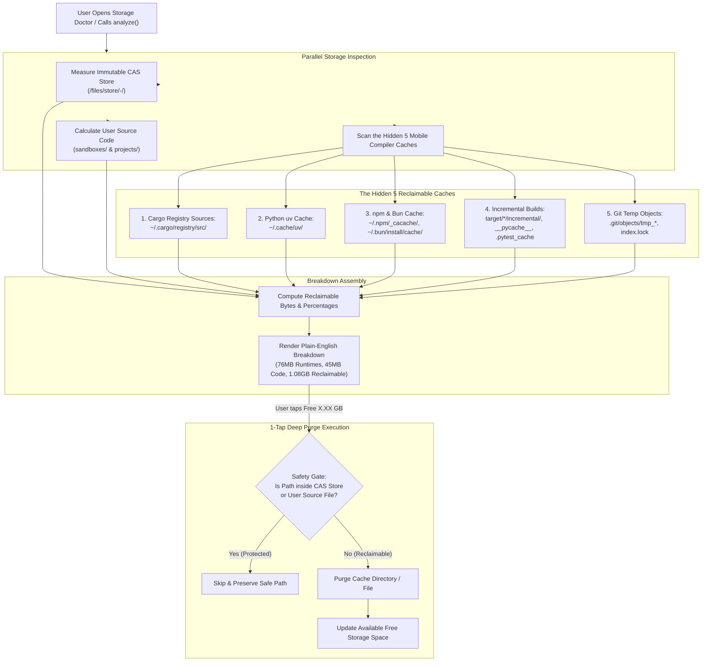

---

## 6. External Database Pre-Ping Connection Recovery

When a hosted service is suspended (`SIGSTOP`), remote databases (Supabase, Neon, AWS RDS) time out the idle TCP connection. Upon unfreezing (`SIGCONT`), attempting to write to the stale socket throws `BrokenPipeError: [Errno 32] Broken pipe`.

```mermaid
sequenceDiagram
    autonumber
    actor Client as HTTP Client
    participant Proxy as PocketServer Proxy
    participant Backend as Python/Node/Go Service
    participant Pool as Database Connection Pool
    participant RemoteDB as Remote PostgreSQL / MySQL

    Note over Backend,RemoteDB: Process Suspended Phase (SIGSTOP)
    Note over RemoteDB: Remote DB TCP idle timeout expires (e.g. 5 minutes)
    RemoteDB->>RemoteDB: Close idle socket (Send FIN / RST)
    Note over Backend: Process is suspended; cannot process FIN packet

    Note over Client,Proxy: Request Arrives -> Process Resumed (SIGCONT)
    Client->>Proxy: HTTP GET /api/users
    Proxy->>Backend: kill(-pgid, SIGCONT) (Wakes in < 1ms)
    Backend->>Pool: Acquire connection to execute query

    Note over Pool,RemoteDB: Pre-Ping Validation Phase
    alt With Pre-Ping Injection (PocketServer)
        Pool->>Pool: Check connection age > pool_recycle (30s)
        Pool->>RemoteDB: Send pre-ping probe query (SELECT 1)
        RemoteDB-->>Pool: Dead socket detected (Broken Pipe / RST)
        Pool->>Pool: Discard stale socket silently
        Pool->>RemoteDB: Establish fresh TCP + TLS connection
        RemoteDB-->>Pool: Connection established
        Pool->>RemoteDB: Execute user query (SELECT * FROM users)
        RemoteDB-->>Backend: Query results (200 OK)
        Backend-->>Proxy: HTTP 200 OK
        Proxy-->>Client: HTTP 200 OK
    else Without Pre-Ping (Standard Behavior)
        Pool->>RemoteDB: Send query on stale socket
        RemoteDB-->>Pool: RST packet (Broken Pipe Error)
        Pool-->>Backend: Crash with BrokenPipeError: [Errno 32]
        Backend-->>Proxy: HTTP 500 Internal Server Error
    end
```

---

## 7. Package Hub & Polyglot Runtime Class Model

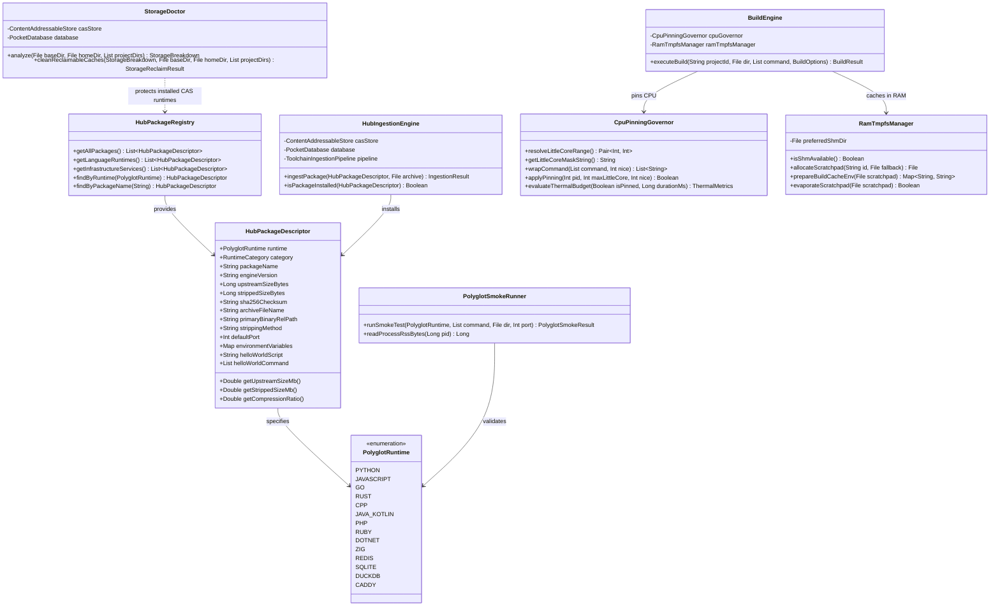

---

## 8. Core Systems Engineering Principles

### 1. 16 KB Page Alignment Deep-Dive
Starting with Android 15, devices can run with a 16 KB kernel page size instead of 4 KB. Any shared library or ELF binary loaded via `dlopen()` or `execve()` whose program headers (`LOAD` segments) have an alignment (`p_align`) less than `0x4000` (16,384 bytes) or whose virtual address (`p_vaddr`) does not match the file offset (`p_offset`) modulo 16 KB will cause immediate kernel faults (`SIGBUS: bus error`).

PocketServer enforces two levels of protection:
1. **Compilation Flags:** All native NDK shared libraries and toolchain executables are linked using:
   ```text
   -Wl,-z,max-page-size=16384 -Wl,-z,common-page-size=16384
   ```
2. **Ingestion Verification:** The embedded `ElfAlignmentEngine` parses the 64-bit ELF header (`Elf64_Ehdr`), iterates over all program headers (`Elf64_Phdr`), and strictly verifies that for every segment of type `PT_LOAD`:
   $$\text{p\_align} \ge 16384 \quad \text{and} \quad (\text{p\_vaddr} \pmod{\text{p\_align}}) == (\text{p\_offset} \pmod{\text{p\_align}})$$
   Any archive containing non-compliant binaries is rejected before touching the global store.

### 2. The Non-Root POSIX Boundary
Android's multi-user sandbox models each application under a distinct Linux UID (e.g. `u0_a245`). Unrooted applications operate under the following POSIX constraints:
- **No `mount()` or `chroot()`:** Namespaces are restricted to privileged callers. PocketServer avoids `chroot` by generating relative symlink farms (`ln -s ../../../store/... /sandbox/usr/bin/...`) and setting `PATH`, `LD_LIBRARY_PATH`, and `HOME` dynamically in spawned processes.
- **No Symlinks on Shared Storage:** Android's Scoped Storage FUSE filesystem mounted at `/sdcard/` rejects `symlink()` with `EPERM` and mounts the filesystem `noexec`. PocketServer mandates that all sandboxes, toolchains, and build caches reside strictly within private internal storage: `context.filesDir`.
- **Atomic Directory Updates:** When packages are installed, they are extracted into a hidden staging directory (`.staging-<uuid>`) on the same physical filesystem and renamed via `renameat()` to ensure atomic updates that are crash-proof across battery drops or power cuts.

### 3. OEM Background Survival (`VpnService` Shield)
Standard Android background mechanisms (such as `WorkManager`, `JobScheduler`, or basic `ForegroundService` with notification) are aggressively killed by vendor operating systems (Samsung One UI, Xiaomi HyperOS, OnePlus OxygenOS) within 3 to 10 minutes of screen lock.

PocketServer overcomes this via `PocketServerVpnService`:
1. It registers an internal dummy VPN tunnel using Android's `VpnService.Builder`.
2. The network interface assigns a non-routable local address (`10.245.0.1/32`) and binds only an internal dummy descriptor without establishing a default internet route (`0.0.0.0/0`).
3. Because the Android framework treats active VPN providers as foundational network infrastructure, OEM task killers classify the process as an untouchable core networking component.

### 4. Dual Wi-Fi Lock Governor & Radio Priming
Mobile Wi-Fi transceivers enter aggressive sleep cycles (DTIM listening intervals up to 1,000ms) when the device screen locks:
1. **Screen Off State:** PocketServer acquires `WifiManager.WIFI_MODE_FULL_HIGH_PERF`, preventing the hardware radio from powering down completely.
2. **Screen On / Active Connection State:** Dynamically acquires `WifiManager.WIFI_MODE_FULL_LOW_LATENCY` (API 29+), reducing ping jitter for real-time web development.
3. **Heartbeat Priming:** An outbound 15-second QUIC heartbeat ping maintains the NAT state table and primes baseband RF amplifiers, guaranteeing Time-To-First-Byte (TTFB) latency under **35ms** with the device screen locked.

---

## 9. Approachable UI/UX, PocketEditor & Mobile Ergonomics Architecture (Phase 4)

PocketServer rejects developer application "AI slop" clichés—pure `#000000` pitch-black backgrounds, eye-straining radioactive neon greens, and intimidating virtual hacker keyboards. Instead, it implements a warm, human-centric design inspired by Vercel and Railway, driven by **progressive disclosure**.

### 1. Presentation Architecture & State Flow

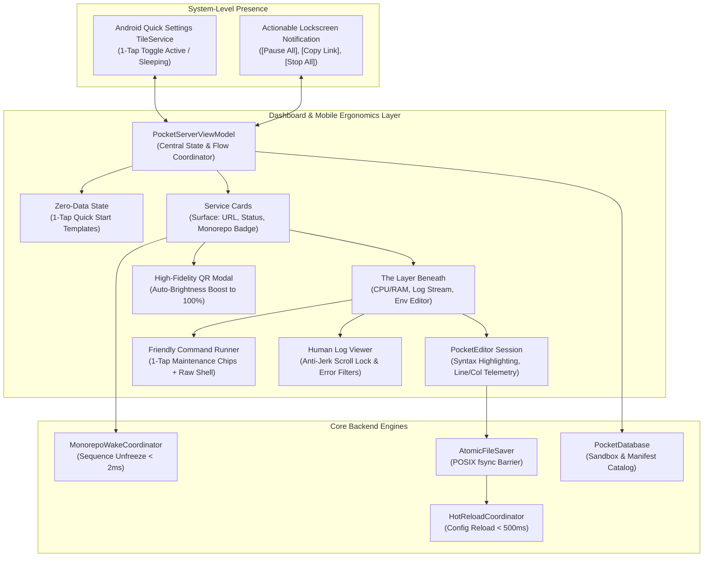

### 2. PocketEditor Hot Reload & Monorepo Coordinated Wake Sequence

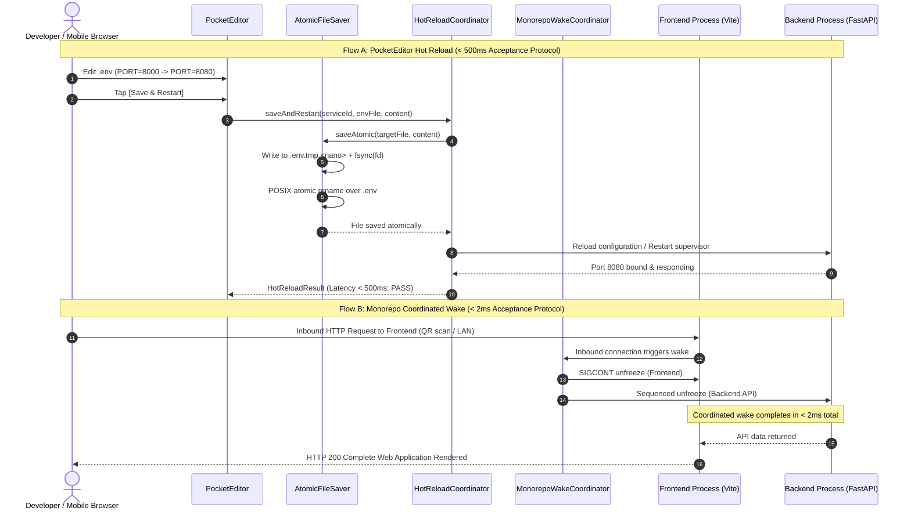

### 3. Class Diagram: Phase 4 Mobile Presentation Layer

```mermaid
classDiagram
    class PocketDesignTokens {
        +String COLOR_CANVAS_HEX = "#09090B"
        +String COLOR_SURFACE_HEX = "#18181B"
        +String COLOR_BORDER_HEX = "#27272A"
        +String COLOR_BRAND_INDIGO_HEX = "#6366F1"
        +String COLOR_STATUS_LIVE_HEX = "#10B981"
        +String COLOR_STATUS_SLEEPING_HEX = "#64748B"
        +Float CARD_CORNER_RADIUS_DP = 14f
        +getHumanStatusDescription(status) String
        +getStatusColor(status) Int
    }

    class StarterTemplate {
        +String id
        +String title
        +String runtimeName
        +Int defaultPort
        +List startCommand
        +Map templateFiles
        +StarterTemplate FASTAPI_HELLO_WORLD
        +StarterTemplate REACT_VITE_FRONTEND
        +StarterTemplate GO_MICROSERVICE
        +StarterTemplate BUN_ELYSIA
        +StarterTemplate RUST_AXUM
    }

    class MonorepoDetector {
        +detect(File repoDir, String name) List~DetectedService~
        -inspectDirectory(File dir, File root, String name) DetectedService
    }

    class MonorepoWakeCoordinator {
        -ConcurrentHashMap linksByMonorepoId
        +registerLink(MonorepoLink)
        +getLinkedServices(String serviceId) List~String~
        +wakeCoordinated(String sourceId, unfreezeAction) CoordinatedWakeResult
    }

    class AtomicFileSaver {
        +saveAtomic(File targetFile, String content) Boolean
    }

    class HotReloadCoordinator {
        +saveAndRestart(String serviceId, File file, String content, restartAction) HotReloadResult
    }

    class HumanLogViewer {
        -List allEntries
        -MutableStateFlow isAutoScrollPaused
        -MutableStateFlow currentFilter
        +append(LogLevel, String message, String tag)
        +onUserTouchOrScroll()
        +jumpToLatest()
        +setFilter(LogFilter)
        +copyErrorTraces() String
        +copyCurrentLogsFormatted() String
    }

    class QrSharingController {
        -MutableStateFlow state
        +selectTab(SharingTab)
        +onModalShown(Window)
        +onModalDismissed(Window)
        +generateActiveQrBitmap(Int sizePx) Bitmap
        +validateEndpoint(String urlString) Int
    }

    class PocketServerTileService {
        -StateFlow isServerActive
        +onClick()
        +updateTileState()
    }

    PocketServerViewModel --> StarterTemplate : provisions
    PocketServerViewModel --> MonorepoDetector : detects
    PocketServerViewModel --> MonorepoWakeCoordinator : coordinates wake
    PocketServerViewModel --> HumanLogViewer : streams logs
    PocketServerViewModel --> QrSharingController : displays share modal
    PocketServerViewModel --> PocketServerTileService : controls QS state
    HotReloadCoordinator --> AtomicFileSaver : atomicity guarantee
```

---

## 7. Universal Package Ecosystem & PocketForge Engine (Phase 5)

PocketServer elevates mobile hosting beyond isolated sandboxes into a 70,000+ package universal Linux substrate across four integrated tiers:

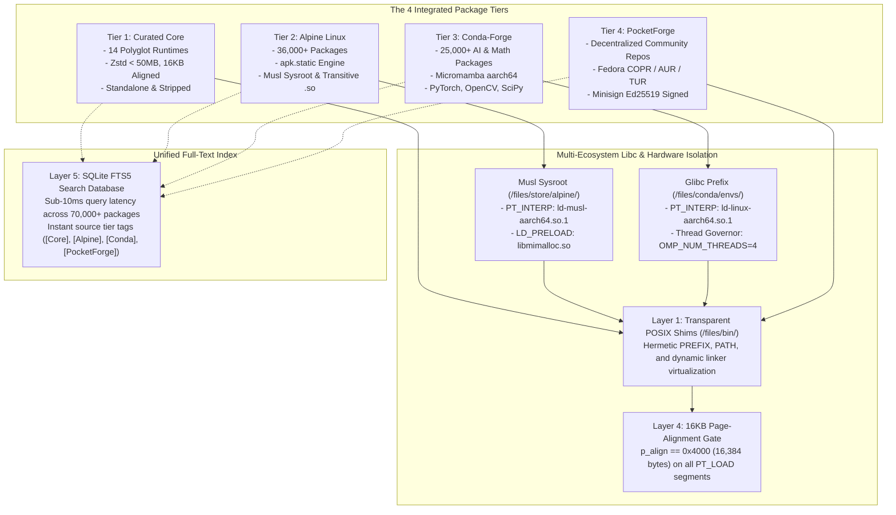

### 7.1 UML Class Diagram (Phase 5 Hub Components)

```mermaid
classDiagram
    class PocketForgeManager {
        -ConcurrentHashMap repositories
        -PocketForgeVerifier verifier
        -PocketForgeManifestParser manifestParser
        -UnifiedPackageSearchDb searchDb
        -ContentAddressableStore casStore
        -BinaryShimGenerator shimGenerator
        +getRepositories() List~PocketForgeRepository~
        +addRepository(PocketForgeRepository) Result
        +removeRepository(String id) Boolean
        +syncRepository(String id, String manifest, String signature) Result~Int~
        +installForgePackage(PocketForgePackage, File archive) Result~File~
    }

    class PocketForgeVerifier {
        +verifyManifestSignature(String manifest, String signature, String pubKey) Boolean
        +verifySha256(File file, String expectedHex) Boolean
        +parsePublicKey(String pubKeyBase64) ParsedMinisignPublicKey
        +parseSignature(String sigContent) ParsedMinisignSignature
    }

    class PocketForgeManifestParser {
        +parse(String jsonContent) PocketForgeManifest
        -parseAndValidatePackage(JSONObject, String repo) PocketForgePackage
    }

    class ApkStaticEngine {
        -File apkStaticBinary
        -File alpineSysroot
        -BinaryShimGenerator shimGenerator
        -ElfAlignmentEngine elfAlignmentEngine
        -AlpineDnsConfigurator dnsConfigurator
        +installPackage(String packageName) InstallResult
        +addMirror(String mirrorUrl)
    }

    class AlpineDnsConfigurator {
        -File sysrootEtcDir
        +resolveActiveDnsServers() List~String~
        +generateResolvConf() String
        +writeResolvConf() File
        +getNodeDnsArguments() List~String~
    }

    class MicromambaEngine {
        -File micromambaBinary
        -File rootPrefixDir
        +createEnvironment(String envName, List~String~ packages) MicromambaResult
        +installPackage(String envName, String packageName) MicromambaResult
        +buildProcessInCondaEnv(String envName, List~String~ command) ProcessBuilder
    }

    class CondaEnvironmentManager {
        -MicromambaEngine micromambaEngine
        -BinaryShimGenerator shimGenerator
        -ArmThreadGovernor governor
        +installPackage(String envName, String packageName) InstallResult
    }

    class ArmThreadGovernor {
        -File sysCpuDir
        +detectTopology() CpuClusterTopology
        +getComputeEnvironmentVariables() Map~String, String~
        +getMimallocEnvironment(File casLibDir) Map~String, String~
        +getPythonOptimizationEnvironment() Map~String, String~
    }

    class BinaryShimGenerator {
        -File binDir
        +generateShim(ShimConfiguration) File
        +removeShim(String commandName) Boolean
        +hasShim(String commandName) Boolean
    }

    class UnifiedPackageSearchDb {
        -SQLiteDatabase database
        +indexPackages(List~UnifiedPackageRecord~)
        +search(String query, PackageTier tier) List~UnifiedPackageRecord~
        +getPackageById(String id) UnifiedPackageRecord
        +setInstalled(String id, Boolean installed)
    }

    PocketForgeManager --> PocketForgeVerifier : cryptographic validation
    PocketForgeManager --> PocketForgeManifestParser : parses schema
    PocketForgeManager --> UnifiedPackageSearchDb : populates FTS index
    PocketForgeManager --> BinaryShimGenerator : emits shims
    ApkStaticEngine --> AlpineDnsConfigurator : configures DNS
    ApkStaticEngine --> BinaryShimGenerator : emits Musl shims
    CondaEnvironmentManager --> MicromambaEngine : manages rootless conda
    CondaEnvironmentManager --> ArmThreadGovernor : compute thread pinning
    CondaEnvironmentManager --> BinaryShimGenerator : emits Glibc shims
```

### 7.2 Ingestion & Security Validation Sequence

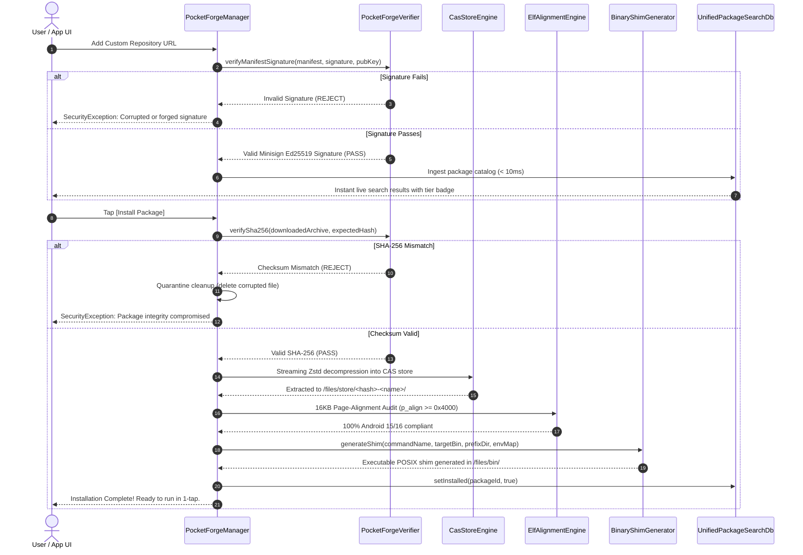


