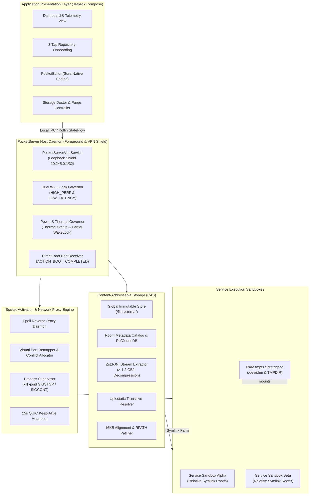
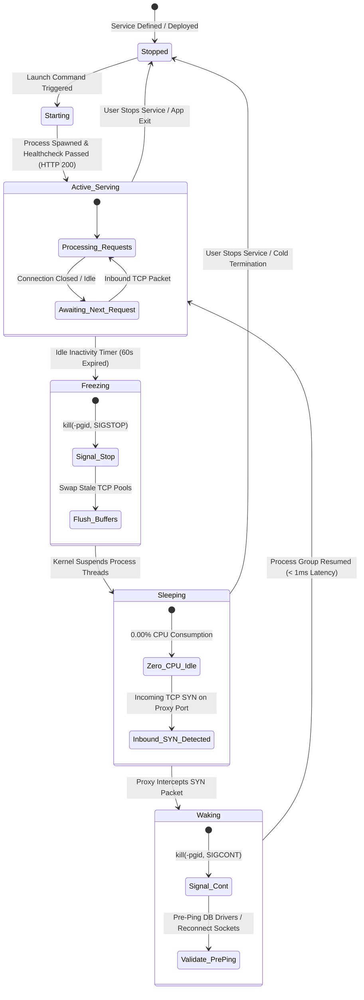
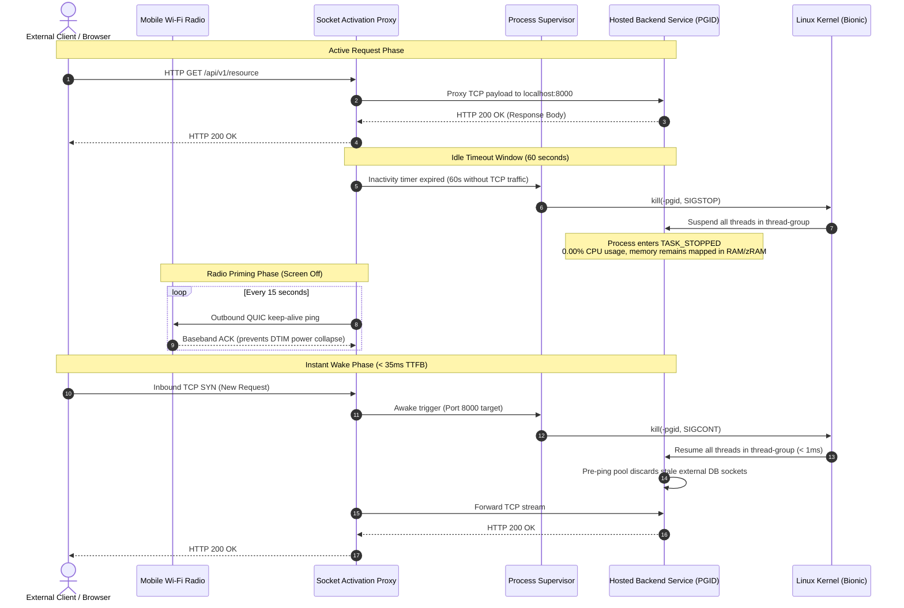
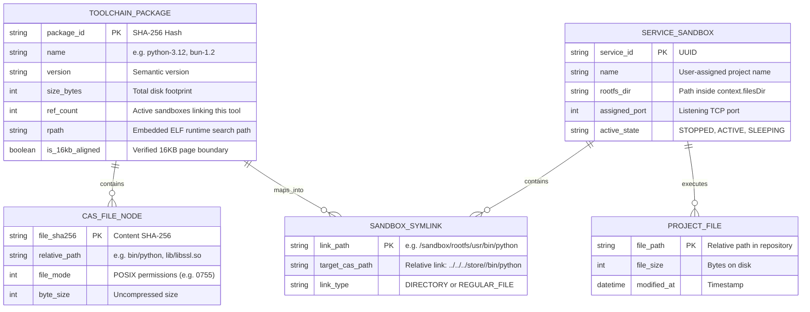
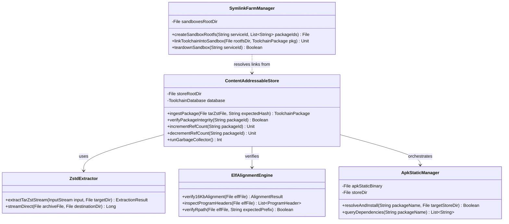

# PocketServer System Architecture & Systems Engineering Specification

This document provides the canonical architectural specification for PocketServer, an open-source, local web service and container hosting platform running on unrooted Android devices.

---

## 1. High-Level System Component Architecture



---

## 2. Socket-Activation & Sleep/Wake State Machine

PocketServer utilizes an epoll-based reverse proxy to decouple network ingress from backend CPU execution. Idle services are transitioned to a frozen state (`SIGSTOP`) where the kernel suspends CPU scheduling entirely while keeping process memory resident. Upon incoming TCP connection requests, the proxy dispatches `SIGCONT` to wake the process group in under 1 millisecond.



---

## 3. Process Lifecycle & `SIGSTOP` / `SIGCONT` Sequence Diagram



---

## 4. Content-Addressable Storage (CAS) & Virtual Symlink Entity Model

To achieve hermetic isolation without requiring container virtualization (such as Docker, namespaces, or `chroot` which require root on Android), PocketServer enforces an **"Install Once, Link Everywhere"** storage design. All packages, runtime toolchains, and shared libraries reside in an immutable global content-addressable store indexed by SHA-256 hash. Per-service sandboxes are constructed dynamically using relative POSIX symlink farms.





---

## 5. Core Systems Engineering Principles

### 1. 16 KB Page Alignment Deep-Dive
Starting with Android 15, devices can run with a 16 KB kernel page size instead of 4 KB. Any shared library or ELF binary loaded via `dlopen()` or `execve()` whose program headers (`LOAD` segments) have an alignment (`p_align`) less than `0x4000` (16,384 bytes) or whose virtual address (`p_vaddr`) does not match the file offset (`p_offset`) modulo 16 KB will cause immediate kernel faults (`SIGBUS: bus error`).

PocketServer enforces two levels of protection:
1. **Compilation Flags:** All native NDK shared libraries and toolchain executables are linked using:
   ```text
   -Wl,-z,max-page-size=16384 -Wl,-z,common-page-size=16384
   ```
2. **Ingestion Verification:** The embedded `ElfAlignmentEngine` parses the 64-bit ELF header (`Elf64_Ehdr`), iterates over all program headers (`Elf64_Phdr`), and strictly verifies that for every segment of type `PT_LOAD`:
   $$\text{p\_align} \ge 16384 \quad \text{and} \quad (\text{p\_vaddr} \pmod{\text{p\_align}}) == (\text{p\_offset} \pmod{\text{p\_align}})$$
   Any archive containing non-compliant binaries is rejected before touching the global store.

### 2. The Non-Root POSIX Boundary
Android's multi-user sandbox models each application under a distinct Linux UID (e.g. `u0_a245`). Unrooted applications operate under the following POSIX constraints:
- **No `mount()` or `chroot()`:** Namespaces are restricted to privileged callers. PocketServer avoids `chroot` by generating relative symlink farms (`ln -s ../../../store/... /sandbox/usr/bin/...`) and setting `PATH`, `LD_LIBRARY_PATH`, and `HOME` dynamically in spawned processes.
- **No Symlinks on Shared Storage:** Android's Scoped Storage FUSE filesystem mounted at `/sdcard/` rejects `symlink()` with `EPERM` and mounts the filesystem `noexec`. PocketServer mandates that all sandboxes, toolchains, and build caches reside strictly within private internal storage: `context.filesDir`.
- **Atomic Directory Updates:** When packages are installed, they are extracted into a hidden staging directory (`.staging-<uuid>`) on the same physical filesystem and renamed via `renameat()` to ensure atomic updates that are crash-proof across battery drops or power cuts.

### 3. OEM Background Survival (`VpnService` Shield)
Standard Android background mechanisms (such as `WorkManager`, `JobScheduler`, or basic `ForegroundService` with notification) are aggressively killed by aggressive vendor operating systems (Samsung One UI, Xiaomi HyperOS, OnePlus OxygenOS) within 3 to 10 minutes of screen lock.

PocketServer overcomes this via `PocketServerVpnService`:
1. It registers an internal dummy VPN tunnel using Android's `VpnService.Builder`.
2. The network interface assigns a non-routable local address (`10.245.0.1/32`) and binds only an internal dummy descriptor without establishing a default internet route (`0.0.0.0/0`).
3. Because the Android framework treats active VPN providers as foundational network infrastructure, OEM task killers classify the process as an untouchable core networking component.

### 4. Dual Wi-Fi Lock Governor & Radio Priming
Mobile Wi-Fi transceivers enter aggressive sleep cycles (DTIM listening intervals up to 1,000ms) when the device screen locks:
1. **Screen Off State:** PocketServer acquires `WifiManager.WIFI_MODE_FULL_HIGH_PERF`, preventing the hardware radio from powering down completely.
2. **Screen On / Active Connection State:** Dynamically acquires `WifiManager.WIFI_MODE_FULL_LOW_LATENCY` (API 29+), reducing ping jitter for real-time web development.
3. **Heartbeat Priming:** An outbound 15-second QUIC heartbeat ping maintains the NAT state table and primes baseband RF amplifiers, guaranteeing Time-To-First-Byte (TTFB) latency under **35ms** with the device screen locked.
