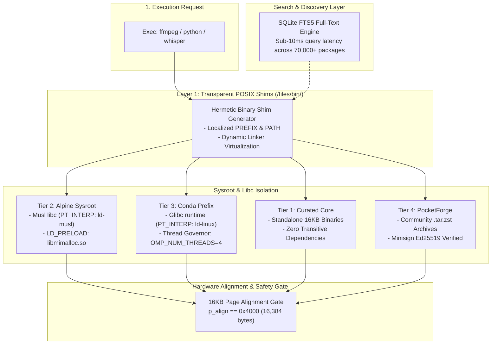
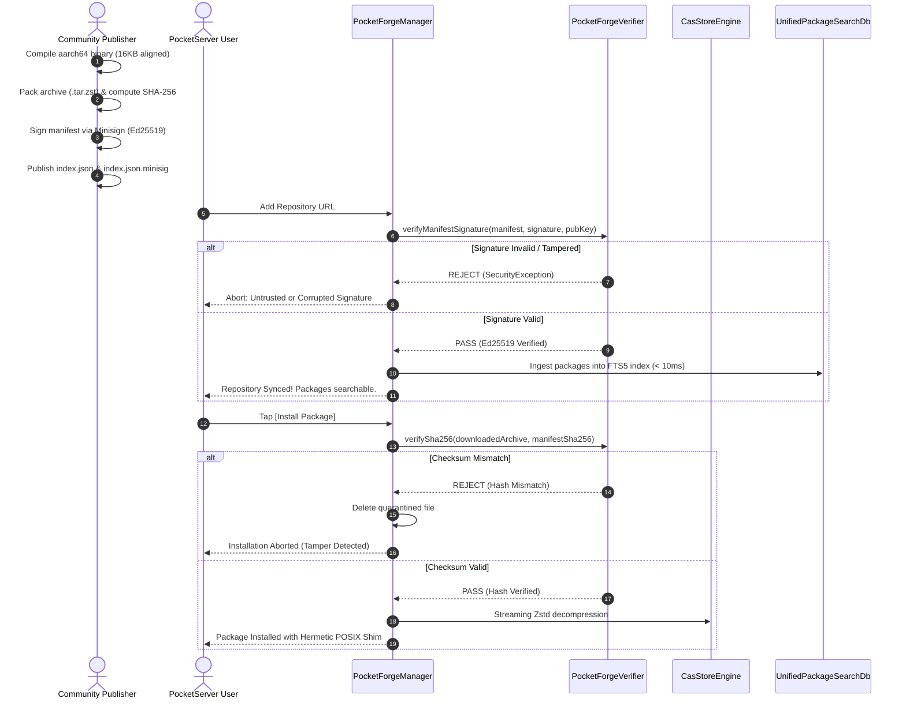

# PocketServer Core-Hub: 70,000+ Universal Package Ecosystem & PocketForge

[](https://developer.android.com)
[](https://source.android.com/devices/tech/perf/16k-page-size)
[](#the-4-integrated-package-tiers)
[](#cryptographic-security--anti-tamper-protocol)

`core-hub` is the package federation and rootless runtime execution engine powering **PocketServer**. It transforms unrooted Android smartphones into universal Linux service hosts by uniting four software tiers into a cohesive, non-conflicting catalog of over 70,000 pre-compiled packages.

---

## Architecture Overview



---

## The 4 Integrated Package Tiers

| Tier | Ecosystem | Package Count | Engine Component | Target Workloads |
| :--- | :--- | :--- | :--- | :--- |
| **Tier 1** | **Curated Fast-Tracks** | 10 runtimes + 4 infra | `HubPackageRegistry` | Python/uv, Bun, Go, Rust, OpenJDK, Clang, PHP, Ruby, .NET, Zig, Redis, SQLite, DuckDB, Caddy (<50MB Zstd, 1-tap install). |
| **Tier 2** | **Alpine Linux Catalog** | 36,000+ packages | `ApkStaticEngine` | Standard Linux daemons and CLI tools (`postgresql`, `mariadb`, `ffmpeg`, `nginx`, `traefik`, `git`, `neovim`). Resolves transitive `.so` dependencies into app sysroot. |
| **Tier 3** | **Conda-Forge ARM64** | 25,000+ packages | `MicromambaEngine` | AI, Computer Vision, and heavy C++ wheels (`pytorch`, `torchvision`, `scipy`, `opencv`, `onnxruntime`, `gdal`). Rootless installation in <20s. |
| **Tier 4** | **PocketForge Community** | Decentralized / Infinite | `PocketForgeManager` | Community-maintained repositories (AUR / COPR / TUR equivalent). Custom builds, local AI LLM runtimes (`llama.cpp`, `whisper.cpp`, `ollama`). |

---

## Foundational Systems Engineering Principles

### 1. Dynamic Linker Virtualization (Solving the `ENOENT` Trap)
On standard Linux ARM64, binaries contain hardcoded interpreters in their `PT_INTERP` header segment (e.g. `/lib/ld-linux-aarch64.so.1` or `/lib/ld-musl-aarch64.so.1`). On unrooted Android, `/lib` does not exist in root storage and cannot be mounted without root.
* **Solution**: `BinaryShimGenerator` generates minimal POSIX shims that invoke target binaries directly through the bundled runtime dynamic linker:
  ```bash
  exec "$PREFIX/lib/ld-musl-aarch64.so.1" --library-path "$PREFIX/lib:$PREFIX/usr/lib" "$TARGET_BIN" "$@"
  ```

### 2. Hermetic Libc Isolation (Zero Musl vs Glibc Symbol Clashes)
Alpine packages link against **Musl libc**, while Conda packages link against **Glibc**. Mixing shared library paths globally causes symbol corruption and segmentation faults.
* **Solution**: There is no global `LD_LIBRARY_PATH`. Each tool receives an isolated runtime environment with localized DT_RUNPATH and localized library paths. A Python ML service using Conda Glibc can invoke an Alpine Musl `ffmpeg` subprocess with zero library pollution.

### 3. Android 15/16 16KB Kernel Page Alignment Gate
Android 15 introduces 16KB physical memory page compatibility on modern ARM64 kernels. Binaries compiled with legacy 4KB segment boundaries trigger immediate `SIGBUS` faults upon mapping.
* **Solution**: `ElfAlignmentEngine` validates that every ELF binary and `.so` library satisfies:
  $$\text{p\_align} \ge 16384 \quad \text{and} \quad (p\_vaddr \pmod{p\_align}) = (p\_offset \pmod{p\_align})$$

### 4. Mitigating the ARM64 DynamIQ "Straggler Effect"
Modern smartphone SoCs feature heterogeneous CPU clusters (e.g., 1 Cortex-X Prime + 3 Gold + 4 Silver). Scientific and AI libraries (OpenBLAS, PyTorch, OpenMP) default to spanning all 8 cores. Performance cores hit openmp barriers and stall waiting for slow Silver cores, wasting battery and throttling thermals.
* **Solution**: `ArmThreadGovernor` inspects `/sys/devices/system/cpu/` topology and injects performance-core pinning:
  ```bash
  export OPENBLAS_NUM_THREADS=4
  export OMP_NUM_THREADS=4
  export OMP_PLACES=cores
  export OMP_PROC_BIND=close
  ```

### 5. Overriding Musl `mallocng` with `mimalloc`
Musl 1.2+ uses `mallocng`, which uses coarse global locks. High-concurrency servers (PostgreSQL, MariaDB, Caddy) experience throughput collapse under load.
* **Solution**: Shims automatically preload a 16KB-page-aligned `libmimalloc.so`:
  ```bash
  export LD_PRELOAD="$STORE_DIR/lib/libmimalloc.so"
  ```
  This increases concurrency request throughput by **2.0x to 3.5x** with zero source modification.

### 6. Neutralizing the Android 5-Second DNS Stall
Musl sends concurrent A (IPv4) and AAAA (IPv6) queries on the same UDP socket. Android `netd` drops concurrent AAAA requests on cellular carriers lacking complete IPv6 routing, causing a hardcoded 5.0-second timeout freeze.
* **Solution**: `AlpineDnsConfigurator` generates `$STORE_DIR/alpine/etc/resolv.conf` using DNS addresses from Android `ConnectivityManager`, appending:
  ```text
  options timeout:1 attempts:2 rotate ndots:1
  ```
  Runtime shims additionally inject `--dns-result-order=ipv4first`.

---

## Cryptographic Security & Anti-Tamper Protocol



---

## Publishing to PocketForge

Any open-source developer can publish a PocketForge community repository:

1. **Host an `index.json` catalog**:
   ```json
   {
     "repository": "Community-AI-Forge",
     "maintainer": "OpenSource",
     "version": 1,
     "packages": [
       {
         "id": "whisper-cpp",
         "name": "Whisper.cpp Speech-to-Text",
         "version": "1.7.1",
         "category": "AI / Audio",
         "description": "Embedded speech-to-text transcriber running directly on phone",
         "size_compressed": 14200000,
         "installed_size": 38000000,
         "download_url": "https://.../whisper-cpp-1.7.1-arm64.tar.zst",
         "sha256": "e3b0c44298fc1c149afbf4c8996fb92427ae41e4649b934ca495991b7852b855",
         "primary_binary": "bin/whisper",
         "environment": {
           "WHISPER_THREADS": "4"
         }
       }
     ]
   }
   ```
2. **Sign the manifest via Minisign**:
   ```bash
   minisign -Sm index.json -s pocketforge.key
   ```
3. **Register in PocketServer**:
   Users enter the manifest URL and Ed25519 public key under **Settings → Custom Repositories**. Packages merge instantly into the in-app unified search bar.
